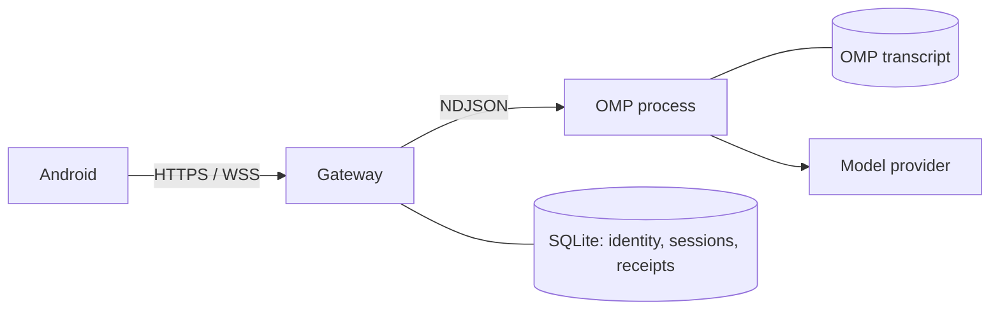

# Architecture

PinkCollab keeps OMP on the host. Android uses Gateway API v4 over HTTPS and WebSocket; the Gateway starts OMP through its local NDJSON RPC interface. See the [protocol](protocol.md) for wire details.

## Host background startup

Windows runs the Gateway as a detached process under the logged-in desktop user. Installation copies the executable to a stable user directory and writes a hidden Startup-folder launcher; no service account credentials are stored. Login starts it, closing the terminal or locking the screen leaves it running, and logout ends it. A named event prevents duplicate instances for the same data directory and signals graceful shutdown. The process record includes its creation time so a reused PID cannot identify an unrelated process. Existing Windows services are removed during an ownership-checked migration. macOS uses a launchd user agent; Linux uses a systemd user service. See [deployment](deployment.md#run-as-a-background-service) for management and migration.

The platform installer owns activation and reports whether it started the Gateway. The `update` command uses that result to wait for local readiness; it does not infer activation from before/after service-status snapshots. A durable pending record retains activation intent across interrupted updates. Configuration and pairing remain in `setup`, not the update flow.

## Three lifecycles

| Object | Identity | Owner | Lifetime |
| --- | --- | --- | --- |
| SessionRecord | `sessionId` | Gateway SQLite | Persistent conversation and display metadata; creating it does not start OMP |
| Runtime | `generation` | Gateway supervisor and OMP | One live process; a later resume uses a new generation |
| Operation | `clientId + sessionId + commandId` | Gateway SQLite | One user's command receipt; retrying its ID never dispatches it again |

The in-memory session controller owns each active session's runtime projection. Its `phase`, `execution`, pending inputs, model, and live messages come from actual process or OMP facts. A completed prompt can leave the process attached and the conversation ready for another prompt. A process slot is released only after confirmed exit. The Gateway checks the workspace again before every startup or resume. That allowlist governs browsing and runtime placement; it is not an operating system sandbox for OMP tools.

Detached-session reads use the persisted records directly; only existing active controllers overlay live state. Prompt-title persistence validates the runtime generation before committing. The committed record is then applied and published by increasing `metadataRevision`, even if that runtime has exited in the meantime.

The supervisor drains OMP output independently of Android and uses a bounded frame reader. Stop is outside ordinary command dispatch, so a waiting prompt RPC or blocked stdin write cannot prevent cleanup. Concurrent stops wait for confirmed process exit; a failed kill or wait leaves the runtime lease in place. On Windows, OMP is assigned to a named, kill-on-close Job Object created before its name is recorded in the durable runtime lease. On Unix, OMP starts in its own process group. Stop terminates descendants and verifies exit before releasing the slot. An unclean Gateway death leaves a durable lease. When a detached Windows session starts or receives a prompt, the Gateway automatically releases that exact old generation only if its recorded job no longer exists; an existing job, even if empty, still protects a possible startup. Lookup failures, legacy leases without job evidence, and Unix leases remain fail-closed and require verified manual recovery. A graceful Gateway shutdown stops processes it owns.

## Data ownership and recovery

| Data | Authority | Recovery behavior |
| --- | --- | --- |
| Host identity, pairing, SessionRecord, OMP mapping, Operation receipt | Gateway SQLite | Preserved across clean restart |
| Conversation and tool transcript | OMP JSONL session file | Read on demand, by branch-bound pages; never copied into SQLite as another authority |
| Delivered attention responses | Successful Gateway SQLite Respond receipts | Durable feedback items merged at their OMP branch anchors; independent of the recent-operation display limit |
| Process state, pending input, current model, live preview | Live OMP process and Gateway memory | Rebuilt from a new snapshot while the process lives; absent after process exit |
| Android history pages | Local display cache | Valid only for the matching source and local view |

An old Session can be resumed by starting a new runtime and loading its server-side OMP mapping. Before a prompt or attention response reaches OMP, the Gateway durably protects that mapping against replacement. A separate, monotonic file-expectation marker distinguishes feedback-only sessions from missing conversation history: prompts, uncertain response outcomes, and observation of an existing transcript require the file to remain available. A successfully delivered response before JSONL creation is anchored at the common root and remains readable without manufacturing an OMP file. Resume may replace an explicitly missing-allowed mapping and move its root feedback references in one transaction. Existing databases migrate conservatively: possibly written mappings require their files. Old unfinished Operations are marked cancelled or outcome unknown on restart and are never sent again automatically. Missing expected history and corrupt history are explicit errors. OMP history and the live WebSocket projection are separate reads, so they do not form a single atomic transcript snapshot.

### Activity and catalog

Session activity is independent of metadata time. `last_activity_at` is written on creation/adoption, prompt acknowledgement and settlement, never per token or on reads. Updates require the leased runtime generation; title changes preserve newer activity samples. Legacy rows fall back to `updated_at`.

A transactional catalog revision clock invalidates metadata fingerprints on insert, delete and public-metadata changes, including SQL changes without a bus event. Canonical engine references are indexed so deletion can check shared ownership without opening unrelated histories. New claims reject duplicate ownership transactionally. The current database schema is 9; older Gateways cannot open it.

Bootstrap selects the newest 50 sessions, the 20 most recently active, attached runtimes and focus. It captures the creation-page cursor before deduplication and projects summaries without detail receipts. A cached, order-independent SHA-256 ledger describes the complete catalog. HTTP pages bind selection and ledger to one SQLite read transaction and Discovery generation, then account for newer controller metadata actually served.

This bounds summary construction, not all catalog work: cold or invalidated ledgers still read O(N) metadata, retain O(N) fingerprints, and may copy them on the first connection-local mutation. Discovery remains bounded and cached; see [discovery limits](deployment.md#refresh-and-discovery-limits). There is no filesystem watcher or transcript copy.

### Public projection and feedback

Gateway internal state is richer than the public protocol. Public DTOs intentionally hide persistence and dispatch implementation details. The runtime projection maps internal phase/execution facts to one public state; receipt dispatch stages map to pending. Session metadata, runtime and operations are authoritative replacements; only the bounded live timeline uses patches.

Answering or cancelling an attention request writes one Gateway-owned `feedback` timeline item only after the response reaches OMP's stdin. Its successful receipt stores the original question, exact answer, delivery timestamp, transcript reference and branch insertion anchor. This is transport delivery, not proof that the model accepted or acted on the answer. Invalid, expired and failed writes create no item; an uncertain delivery/persistence outcome is never invented as feedback. Successful response receipts are retained as history, not disposable receipt-display cache.

Feedback does not modify or copy OMP's JSONL. History pages and synchronization merge it after its captured entry only while that entry is on the active branch, preserving existing message/tool positions. Response delivery, incoming-frame publication, history reads and startup remapping share a dedicated feedback-ordering gate so an answer-triggered assistant entry cannot advance the client's history anchor before its feedback is committed. The lifecycle-state mutex is released during disk and transport work; Stop, process-exit cleanup and session snapshots do not wait for the feedback gate. Stable feedback identities are identical live and restored; command replay cannot send or append them again.

### Synchronization and reconnects

The ordered WebSocket carries a process epoch and scoped sequence positions for replay. Snapshot fences exclude superseded events, with capture/publication ordered under controller locks. These event positions are distinct from REST history and catalog pagination cursors. Broadcast lag uses scoped event replay or a fenced snapshot; oversized events or failed capture can close the connection. A host connection validates the complete catalog and resumes its scope when possible, otherwise captures a bounded snapshot, then resubscribes to the visible session. History remains a separate read with source-bound cursors. A subscribe may request a bounded first page alongside its session snapshot to avoid another connection and round trip; missing inline history falls back to REST, and earlier pages use REST. Local view tokens invalidate asynchronous history responses on unfocus, disconnect, or a fresh snapshot; they are never exchanged over the wire.

A failed open, a closed socket, or a lost default network leaves the host offline. Returning to the foreground or the network becoming available does not open another socket. Authentication-required and upgrade-required hosts stay blocked until the user pairs again or updates the app. An explicit refresh opens one socket with `refresh=1`, forces read-only Discovery even within its 15-second cache lifetime, captures a fresh host snapshot, and resubscribes to the visible session. Concurrent requests waiting on the same Discovery scan reuse it. Try again and ordinary reconnect retain scoped replay and cached discovery.

### Host names

A phone-local host name is stored with the pairing and shown in place of the Gateway name. Navigation keeps the Gateway host and exposes that phone name separately; it does not rewrite `Host.name`. Host snapshots replace the Gateway identity but keep the phone name. Setting the phone name back to the Gateway name removes the override.

## Android navigation

Android's Tasks screen places active sessions first, ordered by `createdAt DESC`, followed by inactive sessions ordered by `lastActivityAt DESC` (falling back to `updatedAt` for older data). Host ID and Session ID break timestamp ties deterministically. Active ordering uses creation time so streamed activity cannot move cards. The top-bar host filter defaults to All hosts and lists phone host names; choosing one host limits the pager, card strip, and earlier-page loads to that host without changing this order. A selection that moves to another host, including a newly created session, returns the filter to All hosts so that session stays visible. Its Timeline pager owns the selected page; the independently scrollable card strip above it follows that page and centers the selected card when space permits. The first card stays at the left edge instead of adding blank leading space. Tapping a card selects its Timeline page; dragging only the strip does not change the selection.

The host filter scopes loading and recovery to the visible host list as well as the session list; a healthy host outside the filter cannot hide the selected host's initial synchronization or connection failure. While that host's session list is still loading, the syncing page shows the selected host's filter label under the title; All hosts leaves that line blank. A previously synchronized catalog stays listed after that host goes offline, but a session with no retained conversation uses the same recovery surface when the host is offline, needs pairing, or needs an app update. It does not present a session-load failure or wait for a snapshot the host cannot send. Filter labels refresh when phone or Gateway display names change. Pagination observes visible session identities and the current paging callback, so switching between equally sized lists cannot load the previous host. Restoring an empty-host filter keeps it selected, and sessions arriving later can become the pager selection without being blocked by the retained selection from another host.

### Focus and startup

Tasks has one route-owned session-focus collector, active only while the app lifecycle is started. It begins during startup and loads the initial session as soon as a host snapshot supplies its summary, using the pager's ordering and the current restored selection when it exists. Every focus change clears the previous session's pending detail request and error, including when the destination host is blocked. The Gateway boundary does not subscribe while the selected host is offline, needs pairing, or needs an app update. Settled pager selections feed the same collector; entering the pager reuses a pending request or valid subscription instead of forcing a second subscribe. Subsequent focus changes are debounced by 200 ms, and a new host snapshot reloads an invalidated subscription. Leaving Tasks or stopping the lifecycle cancels the snapshot wait and pending debounce, so a late startup snapshot cannot initiate focus from another route. Reentering Tasks resolves the current selection rather than replaying a startup capture.

Startup navigation waits for the task list to become ready or unavailable, without a fixed navigation timeout. Before the first usable host snapshot, connecting or synchronizing hosts remain on the animated startup screen and report progress at its bottom instead of switching to a second “Syncing sessions” page. Offline, authentication-required, and upgrade-required hosts make the list unavailable once no initial synchronization remains pending, releasing startup into the existing recovery interface. An empty synchronized snapshot and an unpaired app also release startup. This gate runs only once per app composition; a later explicit reconnect uses the normal task-list recovery flow. Previously synchronized session lists remain available across disconnects.

Each compact session card displays the session title on the first line, with the status in 8sp type at the top-right. The second line prefixes the phone host name to the final component of the workspace path. Position counters are not shown.

### Model selection

The model picker keeps an unset thinking level distinct from the first supported level. Until a supported level is selected, it offers explicit level buttons, including the first level; afterward, multi-level models use a slider with the model's supported-level indices. Apply sends only the user's selected changes.

Opening the model picker for an inactive session automatically starts OMP, then loads the model catalog once the runtime attaches. Sessions on the same host share the available-model list, but each session fetches and retains its own active-model thinking-level fallback because the combined API response includes runtime-specific capabilities. Request state and fallback levels are session-scoped; a replaced runtime invalidates that session's capabilities, while explicit refresh retains usable same-runtime data until the new response arrives. A successful response updates the host's shared model list without replacing another session's fallback levels. There is no default-versus-another-model confirmation step. `SessionOperations` owns each startup attempt across picker dismissal and reopening: command errors (including unconfirmed transport outcomes) and terminal receipts become retryable failures; only a ready subscription snapshot resolves a pending start. The picker derives progress and error presentation from that state instead of retaining its own startup flag.

Session detail separates retained conversation content from current-work status, attention requests, and command receipts. See the [Session Presentation Contract](session-presentation.md) for type catalogs, grouping rules, status precedence, visual behavior, and current support limitations. It defines Android's display policy without changing runtime or transcript ownership.

## Conversations created outside PinkCollab

`discovery::Discovery` adds read-only OMP historical entries to the existing session directory. `origin` explicitly distinguishes discovered and managed entries; discovered entries have no runtime. A generation-less prompt/start adopts them as managed records; deletion also adopts them before durable cleanup, without starting OMP. A SQLite transaction creates the SessionRecord, existing OMP reference and unique adoption association, retaining the public ID. Normal supervisor/receipt handling then resumes it. OMP remains the sole message/tool transcript authority; SQLite owns mappings, receipts and subsequently delivered attention feedback; Android owns only display/cache state.

Storage selection, bounded refresh, and external-writer limitations are documented in [Discovering host OMP conversations](deployment.md#discovering-host-omp-conversations).

## Provider quota display

Usage is a host resource, independent of session runtimes. Gateway reads the configured OMP executable's `usage --json` using the same explicit profile selection as runtimes and discovery, without forwarding runtime-only options. Finite usage commands share RPC process-tree containment: Unix process groups and Windows Jobs. A serialized owner retains the fetch slot through timeout/output-limit cleanup even if the requesting HTTP task is cancelled; successful reads are briefly cached and mapped to public quota DTOs with masked account labels.

Android's host usage loader merges completed fetches into current state atomically, preserving other hosts' pending/results and removals. Opening Usage from Models preserves the model settings draft and does not start an OMP conversation. Provider timestamps remain distinct from snapshot generation time, and missing reports remain unavailable rather than becoming zero usage.
