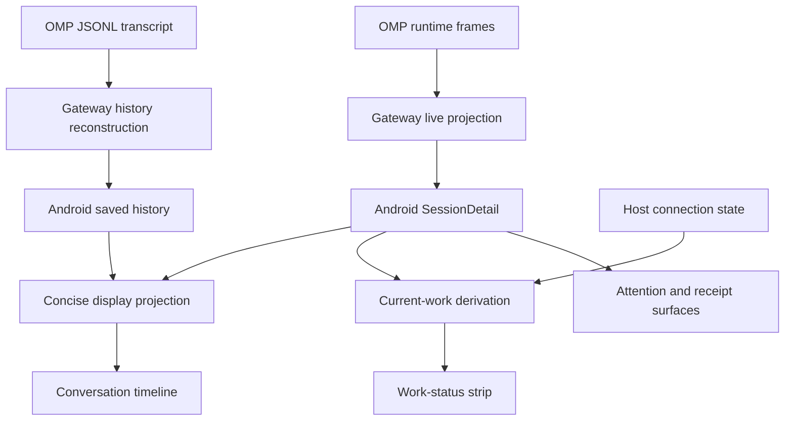

# Session Presentation Contract

## Contents

1. [Scope and terminology](#1-scope-and-terminology)
2. [Data flow and ownership](#2-data-flow-and-ownership)
3. [Source type catalog](#3-source-type-catalog)
4. [Display type catalog](#4-display-type-catalog)
5. [Tool activity contract](#5-tool-activity-contract)
6. [Current-work contract](#6-current-work-contract)
7. [Attention, command notices, and loading states](#7-attention-command-notices-and-loading-states)
8. [Visual and interaction rules](#8-visual-and-interaction-rules)
9. [Acceptance scenarios](#9-acceptance-scenarios)
10. [Extension checklist and implementation map](#10-extension-checklist-and-implementation-map)
- [Host session entries](#host-session-entries)

## 1. Scope and terminology

This document defines how Android presents a session: conversation content, tool activity, current work, interaction requests, and loading or error states. It describes the current implementation, not a proposed set of Gateway events. Sections explicitly labeled **Current limitations** are not implemented capabilities.

The [protocol](protocol.md) owns wire formats and synchronization. The [architecture](architecture.md) owns data authority and lifecycle boundaries. This document owns their user-visible interpretation.

The Android Tasks list places active sessions (`session.isActive`) first, ordered by `createdAt DESC` so live updates do not reorder them. Inactive sessions follow in `updatedAt DESC` order. This is display-only ordering; Gateway ordering and protocol fields are unchanged.

| Term | Meaning | Not equivalent to |
| --- | --- | --- |
| Session presentation | The complete session detail surface | A single scrolling component |
| Conversation timeline | Ordered messages and tool activity in the scrollable content area | A clock-sorted event log |
| Tool activity | One tool call, or a display group of related calls | A Gateway command receipt |
| Work status | The single-line current-work row above the input card in the fixed composer area | A durable transcript entry |
| Attention request | A pending runtime request for a user response | A tool failure |
| Operation receipt | The Gateway's record of a client command | The result of an individual tool call |

### 1.1 Non-negotiable semantics

1. **Describe evidence, not inferred success.** A completed tool is not a completed task. A successful command is not automatically a passed verification.
2. **Separate current work from retained content.** Saved history must not supply current-work status. Disconnection must not imply that the agent stopped or succeeded.
3. **Keep unfamiliar tools visible.** A new tool name must not disappear merely because it has no specialized renderer. This does not imply support for arbitrary new timeline kinds.
4. **Keep mixed outcomes representable.** A group can contain both unfinished and failed operations.
5. **Do not invent progress.** No synthetic percentages, phase completion, elapsed execution time, or reasoning content.
6. **Keep backgrounds static.** Activity surfaces use static tints, not animated noise, shaders, or moving background blooms. Small localized state indicators are permitted.
7. **Keep decisions explicit.** Attention requests require their own response controls; a status label is not an approval.

## 2. Data flow and ownership

| Input | Authority | Presentation responsibility |
| --- | --- | --- |
| Saved history | OMP JSONL, reconstructed for the selected branch | Display retained messages and tool results; never infer live execution |
| Live items | Gateway projection for the current runtime generation | Upsert previews and tools by ID; preserve the supplied order |
| Runtime state | Gateway runtime snapshot | Establish lifecycle and execution evidence |
| Pending inputs | Runtime snapshot | Present the first pending request and its response controls |
| Connection state | Android host connection | Qualify whether current work can be confirmed |
| Receipts | Gateway command records | Report command failure or uncertain outcome separately from tool activity |
| Draft, expansion, and scroll state | Android UI | Preserve local interaction state without becoming execution authority |

### Protocol 4 boundary

Android consumes the flat protocol 4 events through `ProtocolReducer`; OMP frame names in section 3.2 describe Gateway inputs, not Android wire events.

| Wire input | Presentation update |
| --- | --- |
| `host_snapshot` | Replace host summaries; invalidate old details and take fresh snapshots for the visible session |
| `session_snapshot` | Replace session detail, model, live timeline, and recent receipts; load saved history when `hasHistory` is true |
| `session_state` | Replace session metadata and all runtime facts in the host list and subscribed detail |
| `session_upsert` | Insert or replace the session summary; update an already subscribed detail when present |
| `timeline` | Apply reset, removals, and upserts to live items only |
| `operation` | Replace a receipt by its `id`; interpret public `state`, never internal dispatch stages |

`runtime.state` is the sole wire status: `starting`, `idle`, `running`, `waiting_input`, or `stopping`. A null runtime clears generation, model, pending input, and work timing. Generation changes clear the live tail and invalidate in-flight history reads; saved history reloads when a mapping exists. Local snapshot tokens and history epochs reject stale responses and are never sent over the wire. The UI does not parse runtime `phase` or `execution`, or choose prompt delivery; the Gateway chooses normal versus steering at dispatch.

Switching sessions invalidates the subscription snapshot, not the host connection. While an online host supplies a fresh snapshot, retained messages remain readable and the page shows conversation synchronization instead of current work or `Host offline`; runtime controls stay disabled. Actual host connection failures still take precedence, even when the session snapshot is missing. With no retained conversation, that failure uses the host recovery surface rather than a session-load failure.

### Session switcher status

The top session cards derive status from the host connection and session runtime summary. Connection states take precedence over retained execution evidence. Online cards show On host for a discovered session. Otherwise they show Starting or Stopping during lifecycle transitions, Inactive when a managed session has no runtime, Needs you for pending input, `Working` for `running`, and `Ready` for attached `idle`. Starting includes execution not yet confirmed by the Gateway. Ready does not claim task completion; Inactive does not imply the session has never run. Cards do not infer status from transcript text or tool results.

The switcher uses 168dp-wide graphite cards with 13dp corners, matching the Todo panel. Selected cards use an opaque deep-violet gradient derived from the graphite base and brand purple, with a high-contrast white title and pale-violet host and directory text; no border. Unselected cards keep a subdued graphite fill. Status uses text only, without a small dot: Ready uses teal; Working/Starting/Stopping use violet; Needs you/Sign in/Update required use amber; On host, inactive, and disconnected states use muted text. Selected cards use lighter violet and neutral status shades to preserve readability against the stronger fill. Status is also exposed as `stateDescription`; selection has its own accessibility state. The strip grows with font scale rather than squeezing the title or the host and directory line. The status is an 8sp label at the top-right of the title row and truncates on its own. Scrolling, centering and session ordering are unchanged.

The phone host name is prefixed to the workspace's final path component, separated by `›`. The host name is capped so a long name cannot consume the project name; each truncates independently. Status does not share that row. A long connection status truncates in the corner and must not cover the title or the host/project line at enlarged font sizes.
The card-strip background transitions upward from fully transparent 13dp below the cards' bottom edge to fully opaque `Base0` at the cards' vertical center line, then stays opaque above that line. The gradient extends 8dp beyond the strip without moving its solid endpoint away from the card center. There is no separate black shadow. The conversation timeline runs underneath the strip, so scrolling earlier content passes behind that ramp. Card fills are opaque, and the strip reserves its height in the timeline's top content inset so the first item is not hidden.

### 2.1 Ordering and source boundaries

- The page renders one conversation timeline. History defines branch order; live items replace shared identities and extend that timeline. There is no separate live section or duplicate-message warning.
- Gateway supplies `sourceId` for final messages, derived from the message's role, original timestamp and complete text. RPC process-local IDs and JSONL entry IDs are not interchangeable. `messageKey` bridges persistence-before-message-end races only when the lifecycle timestamp is unambiguous in both sources. Never deduplicate by text alone.
- RPC message IDs remain runtime-generation scoped; tool call IDs are shared with history. Patches replace IDs and remove live-window entries. Completed entries leaving that window are retained in the loaded conversation until authoritative history replaces them. Final history retains the live item's UI key during handoff.
- A tool result updates its existing call rather than creating a second operation. Gateway merging retains the call's original position and timestamp, fills missing metadata, and does not undo completion or error flags.
- Assistant text deltas update an assistant item. The final message replaces the matching draft; late deltas cannot extend a finalized message.
- Timestamps are display metadata, not a reason to reorder items. Message labels use local time, adding a date for older messages; invalid timestamps have no label. These message timestamps and the composer’s Gateway-backed work duration remain separate from timestamps inside source results. Tool previews do not repurpose a call timestamp as source metadata or invent per-step timing.
- User and assistant text is complete, including long streaming replies and final messages. The live window is bounded by item count, not an 8 KiB text preview. History remains the durable authority. Turn settlement refreshes history without clearing the visible conversation. An `anchor` branch leaf lets Gateway prove append continuity before retaining previously loaded pages; changing branches replaces their content.

## 3. Source type catalog

### 3.1 Timeline payloads

`TimelineItem` contains `id`, `kind`, `text`, `detail`, `timestamp`, and an optional `tool` payload.

A timeline `ToolTrace` contains `callId`, `name`, `isError`, `completed`, `summary`, `detailsAvailable`, `detailsVersion`, and optional `todoPhases`. `arguments` is null and `result` is empty in every snapshot, live patch and history page. Gateway extracts bounded summary action, target, affected files and error text. Structured flags, not display phrases, determine tool state.

| `kind` / condition | Current producer | Concise presentation | Boundary / update behavior |
| --- | --- | --- | --- |
| `user`, nonblank text | Live finalized user message; reconstructed history | `Message`, role `user` | Ends the preceding activity group |
| `assistant`, nonblank text | Live text delta/final message; reconstructed assistant text | `Message`, role `assistant` | Ends the preceding activity group; live text can be replaced in place |
| `tool`, structured trace present | Live tool start/end; historical tool call/result | One operation inside `ActivityGroup` | Joins the continuous work sequence; completion updates the same call |
| `tool`, trace absent | Tolerated partial or older input; not the normal structured producer | `Raw` fallback | Ends the preceding group; does not invent structured status |
| `error` | History reconstruction of an assistant error with array content; also accepted by Android | `Error` | Ends the preceding group |
| `feedback` | Gateway's successfully delivered attention response, restored from its durable command receipt | `Feedback`, original question and user's answer | Ends the preceding activity group, including empty answers; stable source identity joins live and saved history |
| `user` / `assistant`, blank text | Accepted input | Omitted | Does not end a group |
| Any other kind | Not currently emitted as a dedicated timeline kind by the inspected live/history producers | Omitted in concise mode | Does not end a group |

### 3.2 Runtime events that are not timeline kinds

| Runtime input | Projection effect | User-visible destination |
| --- | --- | --- |
| `agent_start` | Execution becomes active | Current-work derivation |
| `session_settled` | Execution becomes quiescent | Ready state, not a success claim |
| `prompt_result` | Updates receipt; may also settle execution | Receipt notice and work status |
| `extension_ui_request` | Adds a supported pending input, or removes a cancelled request | Attention card and waiting status |
| `model_changed` | Refreshes runtime model state | Model controls / applicable headers |
| `tool_execution_start` / `tool_execution_end` | Upserts a `tool` item | Activity group and current-work derivation |
| Assistant `message_update` text delta / `message_end` | Upserts/finalizes an `assistant` item | Conversation message |

**Current limitations:** thinking content, context compaction, plans, and subagent lifecycle events do not have dedicated concise timeline entries. History reconstruction ignores non-message entries and unrecognized assistant content parts. A `task` or `agent` tool call is visible as tool activity, but is not a child-agent progress tree. The raw renderer recognizes the label `subagent`; that alone does not constitute end-to-end subagent support.

## 4. Display type catalog

`SessionDisplayItem` is a display projection, not a wire enum.

| Display type | Default content | Expandable content | Interpretation |
| --- | --- | --- | --- |
| `Message` | Speaker, local time, text; assistant text uses Markdown | No activity expander | User/assistant content, not a runtime status |
| `ActivityGroup` | Current action while live; call-count summary after folding, with failure/uncertainty evidence | Compact vertical steps with independent summary previews | A compact group of tools, not a plan step |
| `Error` | Error heading and concise text | Nonblank detail that differs from the summary | A supplied error; not automatically the whole session's outcome |
| `Feedback` | Your response heading, local time, original question and exact selected/submitted answer; only zero-length text displays `(Empty response)`. Nonempty whitespace is preserved and copyable | None | Transport-delivered user response, not model acknowledgement |
| `Raw` | Generic kind label and supplied text; assistant text uses Markdown | Tool/subagent details when available | Fallback without inferred structured semantics |

Error summaries use the last nonblank line, capped at 180 characters, falling back to `Failed`. The standalone error expander uses the supplied `detail`; it is not a reconstructed full error log.

`SessionDisplayMode.Concise` is the page's default. `Debug` maps every supplied item to `Raw`, bypassing grouping and filtering. **Current limitation:** the session page does not expose a mode selector; `Debug` is a projection capability, not a shipped user-facing view.

## 5. Tool activity contract

### 5.1 Stage classification

Classification lowercases the tool name and uses its final `.`- and `/`-separated component. Prefixes below are literal string prefixes.

| `ActivityStage` | Exact names | Prefixes |
| --- | --- | --- |
| `Explore` | `read`, `grep`, `find`, `glob`, `search`, `web_search`, `lsp` | `read_`, `grep_`, `find_`, `glob_`, `search_`, `lsp_` |
| `Change` | `edit`, `write`, `ast_edit`, `apply_patch` | `edit_`, `write_`, `ast_edit_` |
| `Execute` | `bash`, `shell`, `exec`, `test`, `python`, `eval`, `js` | `bash_`, `shell_`, `exec_`, `test_`, `python_`, `eval_` |
| `Other` | Every remaining tool name, including `task`, `agent`, and `wait` | Fallback |

Stages classify individual operations for step icons and call-count summaries; groups have no aggregate stage. They do not prove what an operation accomplished. In particular, `Execute` does not mean “Verify.”

### 5.2 Group boundaries and focus

1. Consecutive structured tools join one continuous work sequence, including changes between exploration, modification and command execution.
2. Nonblank user/assistant messages, feedback (including an empty answer), standalone errors and unstructured tools end a sequence.
3. Ignored items and structured Todo snapshots do not split a sequence. End of input flushes the remaining group.
4. History and live items merge before projection; source handoff does not split a sequence.
5. The live header focuses the last unfinished current-turn operation, otherwise the latest call. Its action changes with a 260ms vertical fade/slide transition. Between calls the sequence remains open, without claiming that a completed tool is still running.
6. A folded sequence summarizes observed search, read, change, command and other-call counts. These are tool-call counts, not verified task or file counts. Failure counts, latest supplied error and unfinished-call uncertainty remain visible.

### 5.3 Status and live qualification

Individual status still comes only from structured flags: unfinished is Running; completed with an error is Failed; otherwise Completed. Historical unfinished calls display a static hourglass and `Last seen running`.

Only the final visible activity group may automatically open, and only when the selected page is active, its subscribed host is online, the runtime is attached and Running, no attention request or separate streaming reply is present, and the group contains a live call after the newest live user message. Matching uses tool call IDs, not timeline item IDs. An unfinished step animates only if its own call belongs to that current live turn. Older groups and saved-only calls cannot become current work.

A qualified sequence opens automatically with a small localized pink work indicator. A faint vertical rail connects its icon-and-intent rows. The live sequence title and the focused running step use a neutral highlight sweeping horizontally across the glyphs; settled and disconnected titles stay still. The newest focused step opens a rounded preview using supplied targets/files; when another step takes focus, the previous automatic preview closes. Heights animate over 240–300ms and disclosure arrows rotate over 220ms. New live steps fade and rise 6dp over 260ms; result/status updates and reopening an already seen step do not replay that entrance. Manual sequence folding survives new calls and status updates in the same live phase. Manually opened or closed step previews remain explicit choices while the group is mounted.

When a reply appears, runtime settles, attention arrives, the page loses focus or the host disconnects, the sequence folds to its call-count summary. It remains manually expandable. The header and each expandable step expose their expanded/collapsed state and button action. There is no horizontal stack of overlapping status icons. Step rows have a compact 32dp minimum height, flexible two-line intents and a decorative disclosure chevron. Historical groups start folded. A successful folded summary has no success checkmark; failure and unfinished indicators remain explicit.

### 5.4 Intent extraction

| Value | Selection rule |
| --- | --- |
| Action | First nonblank argument in `i`, `description`, `title`; otherwise supplied summary action, then a tool-specific verb |
| Default verbs | Read, Search, Edit, Write, Run command, Execute code, Delegate work, or Wait for work for recognized families; otherwise `Tool activity` |

Argument intent is supplied descriptive text, not a verified conclusion. Long summaries are ellipsized; detailed content remains separately accessible when supplied.

Live and saved calls use the same intent fields. Only execution events establish live tool activity. Finalized assistant `toolCall` arguments from `message_end` replace matching live call arguments without changing results, completion/error flags, timestamps or timeline positions. Unmatched declarations are retained from the latest assistant message until execution supplies the call; they never create timeline entries or resurrect calls retired from the bounded live timeline. Original assistant arguments take precedence over execution snapshots that omit intent. Updated intents use the normal live timeline stream; reloading history is not required. Summary extraction skips blank intent fields before considering the next candidate. If no descriptive intent is supplied, the tool-specific verb remains the fallback rather than inventing a description from output.

`cargo test --all-features --locked --test transcript_details live_tool_intents_survive_execution_and_match_history` exercises live publication and history parity with execution arguments that omit intent, metadata arriving before execution or after failure, multiple calls in a tool-only assistant message, and a blank `i` followed by a nonblank `description`. `late_tool_metadata_does_not_resurrect_retired_or_unexecuted_calls` covers late declarations after 65 completed calls: retained calls stay completed, retired calls remain absent from the live timeline but have complete durable details, and unexecuted declarations remain hidden.

Step previews use the supplied summary target and affected files, deduplicated, with at most three displayed plus an overflow count (Gateway caps the supplied affected-file list at 32). Legacy inline payloads can supply argument targets and a first-three-line, 360-character output preview. Protocol 4 normally supplies summary metadata only; opening a preview does not fetch output. The concise projection retains only operation identity, intent, status, errors, targets and bounded previews, plus the group's latest error summary. It does not construct full argument/output strings, synthesized diffs or detail-loader metadata. Complete arguments remain available in debug/raw full details.

### 5.5 Detail types

Every step with supplied targets, error or output preview has an independent preview disclosure. Operations without any such content retain their intent and accessible outcome without an empty expander. A preview shows available summary targets, error and bounded output without a redundant tool-name/status header. Completed and Running are accessibility descriptions, not visible badges; failures retain their error content and folded warning. The timeline has no full-detail button. Single-operation groups use the same preview controls. Opening a sequence or preview never starts a detail request. The debug/raw renderer retains its full-detail loader.

Details come from authenticated `GET /api/v4/sessions/:id/tools/:callId?cursor=...`: current calls use Gateway memory and retired calls use the active OMP history branch. Each page carries complete UTF-8 text up to 32 KiB, an opaque prefix-hash/byte-offset cursor and a content version. Android caches by session, runtime generation, call ID and version, deduplicates requests, limits refreshes to two per second per call, and retains opened panels while evicting idle cached content over 4 MiB. In-flight failures appear locally with Retry. Load more and running-tail polling append only after the server validates the received prefix; a rewritten prefix reloads the first page. Completion reuses the resume cursor without duplicating arguments. Ordinary output progress keeps the summary version stable; start/availability changes and final status update summaries without folded payloads. Expanded running tails poll at 500 ms intervals; collapse or disposal stops polling.

The debug/raw detail stream shows pretty-printed argument JSON followed by full output. Patch and file content remain lossless within their arguments; no synthesized diff or duplicate output is added by the concise projection. Gateway summary file extraction accepts direct/list arguments, recognized unified or patch-header paths, and OMP anchored edit headers in `input` and results. Anchored input accepts optional `*** Begin Patch` / `*** End Patch` envelopes, leading blank lines and LF or CRLF line endings. Its `+TEXT` body rows are preview content even when they begin with `+++`; only unified-diff headers are excluded from unified previews and used as file paths. Edit summaries retain a filename fallback and a bounded supplied patch preview; completed tools may supply a bounded output preview without a detail request; it is not a filesystem audit.

Opening a previous step does not close another step the user opened manually during the same work phase. When a new Agent reply begins, every tool group and preview folds, including manually opened earlier groups, before the session status becomes idle. Text deltas for that same reply do not repeatedly reset disclosures, so the user can reopen them while reading. Timeline previews remain bounded summary content. In the debug/raw renderer, expanded full output remains selectable and vertically scrollable within a bounded height; collapse or disposal stops polling. Failures and unfinished states remain distinguishable by text and icons after folding; no inferred task-success badge is shown.

### 5.6 Todo panel

The floating todo panel uses the shared purple/pink gradient and rounded graphite surfaces from [Effects.kt](../android/app/src/main/java/dev/pinkcollab/ui/theme/Effects.kt). Its compact header is a single rounded progress track with `TODOs` and the settled count (for example, `3/3`) centered together inside it. A status icon or active dot sits at the left, and the expand/collapse arrow sits at the right; focus-task text remains in the expanded task sheet instead of the header. The translucent progress fill keeps the labels readable, and a settled plan reduces its visual emphasis. The expanded task sheet retains phase labels and explicit task-state icons. The header starts at 40dp and grows with font scale. The conversation viewport extends behind the pinned panel: header clearance belongs only to the scrollable list's starting content padding, never to a separate fixed top region. The initial clearance follows the header height plus 12dp and the timeline's normal 8dp inset, then scrolls away with the conversation.

Tapping the banner reveals the task sheet downward over 420ms; closing reverses the motion over 320ms. The banner remains pinned while the bounded task sheet scrolls independently. Phase headings, phase counts and task rows remain the only expanded content, with no raw arguments/output expander. Expansion does not shift messages or cover the composer. The panel and transparent dismissal area share a top boundary below the session-card strip; the height budget subtracts that boundary, measured composer clearance, and keyboard overlap. The panel is additionally capped at 65% of the page height remaining below the strip. Outside taps and Back still close the panel.

The outside-tap dismissal area is transparent: expanding the Todo panel does not draw a black scrim over the conversation. The panel's own rounded fill and shadow remain unchanged.

During live work, active-task violet dots in both the focus header and expanded task rows breathe with synchronized scale and opacity changes over a 2.2-second cycle. Animation affects drawing only, so the card and row bounds remain stable. Retained/offline plans and non-active task states do not animate their dots.

## 6. Current-work contract

During active work, the timeline owns the action label and Thinking animation; the fixed work-status row shows only muted duration and token speed. Other states retain their status icon and title, followed by an optional muted duration separated by whitespace, without a dot. Optional Gateway `workTiming` is the sole duration authority: Android adds local monotonic time only while the sample is running and the host is online. Pending input freezes the duration; disconnection hides it. A settled sample replaces Ready with `Worked for 1m 23s`, without claiming success. This summary remains until new work or runtime exit; it is not a durable transcript entry. Missing timing displays no fabricated counter. Work-status metadata uses spacing, commas, or parentheses instead of middle-dot separators; tool-count summaries use middle dots; authored message content is unchanged.

### 6.1 Placement and inputs

The sole status row is mounted above the input card, not inside it, including while session detail is loading. It belongs to the fixed composer area, stays outside the scrolling timeline and contributes to the composer's measured clearance. It remains visible while the user reads earlier messages. The conversation shows a small `Working on it…` placeholder before tools arrive or between message/tool phases while execution is live-qualified. A continuous tool sequence replaces that placeholder while it is the latest visible work. The fixed composer status row remains the authority for connection, timing, speed and attention.

`sessionWorkStatus` derives `kind`, `title`, `active`, optional `timing`, and optional `tokensPerSecond` from `SessionDetail` and host connection state. The renderer contains one line. During `Working`, it shows optional duration on the left and muted token speed pinned to the right, without a repeated icon, action label or animation. Other states show an icon, ellipsized title, optional duration and the same right-aligned token speed. Speed is rounded to an integer, for example `42 tok/s`; unavailable speed displays `… tok/s`. The title yields space to the duration and speed rather than wrapping. Auxiliary target, command, file-name and request-text lines are removed; attention cards retain actionable request content. Model, thinking-level and Fast controls are separate and unchanged.

For states other than `Working`, when the work-status title changes, the old text slides upward out of the single-line clipped viewport and the new text enters from below over 260ms, with a short fade. The transition is keyed only by title text: unchanged titles, icon changes and elapsed-time ticks do not trigger replacement. Icons and durations do not slide, the row height stays stable, and platform animation-duration settings are respected. Only the current title remains exposed to accessibility during replacement.

`SessionPage` uses the same user-facing label, `Loading conversation`, while detail is pending, an online host's subscription snapshot is missing, or an empty conversation is waiting for its initial history. Internal loading stages remain distinct without asking users to interpret them. Initial history loading replaces only Ready or OnHost; known work, attention, sending, and host connection statuses retain precedence. Loading uses neutral text without the sending highlight, with an animated download arrow above a stationary tray and no work timer or progress bar. The 16dp icon keeps fixed layout bounds; only the arrow moves, and system animation-duration settings remain respected. Starting and stopping retain their static hourglass icons. Loading never enables actions from summary or cached detail, and a detail failure removes the loading row.

### 6.2 Precedence table

Evaluate top to bottom; the first matching row wins.

| Priority | Condition | `WorkStatusKind` | Meaning / title | Active indicator |
| --- | --- | --- | --- | --- |
| 1 | Host absent or not connected | `Offline` | Connecting, syncing, sign-in/update required, or offline; current work cannot be confirmed | No |
| 2 | Discovered origin | `OnHost` | Session on host | No |
| 3 | Session starting | `Starting` | Starting agent | No |
| 4 | Session stopping | `Stopping` | Stopping agent | No |
| 5 | Attention object, attention flag, or needs-input status | `Attention` | Waiting for your input; the conversation card owns request content | No |
| 6 | Runtime detached | `Ready` | Ready for a message | No |
| 7 | Attached runtime is idle | `Ready` | Ready for a message | No |
| 8 | Current live turn contains unfinished structured tools | `Working` | Tool intent; concurrent count when applicable | Yes |
| 9 | No unfinished tool and `detail.streaming` nonblank | `Working` | Writing reply | Yes |
| 10 | Runtime state is running with none of the above | `Working` | Thinking | Yes |

`Thinking` is a generic active-work fallback, not evidence of a particular reasoning event. `Ready` is availability for another message, not a task-success verdict. There is no `Completed` or `Failed` work-status kind; errors and tool outcomes have their own surfaces.

### 6.3 Current-tool selection

- Scan `liveItems` backward and stop at the newest `user` item.
- Count structured `tool` items whose `completed` flag is false. The first found in the backward scan supplies the current intent.
- If the bounded live tail has no user item, scan the available tail. Do not consult history to invent a missing boundary.
- One unfinished tool shows its intent. Multiple tools show `N tools running`, without a second-line description.
- Completing one tool removes it from this selection; starting a new user turn excludes unfinished tools before that boundary.

The strip uses the first nonblank `i` or `description` as intent, otherwise a tool label. Read/search/edit/command families have specific labels; other names use `Using <tool>` or `Running tool`.

The status row and timeline share a normalized, typed tool identity. Their classification and intent policies remain surface-specific: the timeline recognizes more prefixes and also considers `title`, while the status row recognizes additional exact command aliases. Do not assume their labels must be byte-identical.

### 6.4 Streaming support boundary

The UI can render nonblank `SessionDetail.streaming` as an open reply and label it `Writing reply`. **Current limitation:** the Android reducer does not populate this separate field. Current Gateway text deltas arrive as updates to `liveItems` of kind `assistant`. Thus the separate streaming reply and status branch are not guaranteed to appear during a real reply; the active fallback can remain `Thinking` while assistant text grows.

## 7. Attention, command notices, and loading states

These surfaces are composed by `SessionPage`; they are not variants of `SessionDisplayItem`.

### 7.1 Attention requests

| Request type | Android presentation | Response |
| --- | --- | --- |
| `select` | One button per supplied option | Selected string |
| `confirm` | Decline and Confirm | Boolean |
| `editor` | Multiline answer field | Submitted string |
| `input` or another unrecognized type | Generic answer field | Submitted string |
| Any displayed request | Cancel action | Explicit cancellation |

The Gateway currently admits `select`, `confirm`, `input`, and `editor` requests. Android projects the first pending input into `session.attention`; it does not render a queue of request cards. Response controls require a connected attached runtime and no input-busy operation. The status strip summarizes waiting; the card owns the actual response.

Attention requests use an inset, neutral card with proportional reading text and a distinct question heading. Select options are full-width, left-aligned rows with wrapping labels and at least 48 dp touch targets; tapping still submits the original option string immediately. Cancel is a secondary, trailing action. Connection and operation gating apply to every response control.

Successfully delivered selections, confirmations, text/editor submissions and cancellations leave a `feedback` entry in the conversation. It displays the original question with the exact selected/submitted text, `Confirmed`, `Declined`, or `Cancelled`, under `Your response`. Empty text remains a visible response boundary. Replayed commands do not duplicate entries; rejected, expired or failed deliveries create no answered record. Gateway stores feedback in its successful command receipt, anchors it to the active OMP branch, and merges it into live/history ordering. Records survive reconnect, reopening and Gateway restart without modifying OMP's transcript or claiming that the model acknowledged the answer. Existing responses from before this feature are not reconstructed.

### 7.2 Command receipt notices

Only the last receipt is considered for the page's notice:

| Protocol 4 receipt state (Android status) | Presentation |
| --- | --- |
| `unknown` (`OutcomeUnknown`) or unrecognized status | Result cannot be confirmed; inspect the conversation before trying again |
| `failed` (`Failed`), prompt command | Message could not be sent |
| `failed` (`Failed`), other command | Action could not be completed |
| `pending`, `succeeded`, `cancelled` | No receipt notice |

Receipt notices must not be interpreted as individual tool outcomes or as automatic retry instructions.

### 7.3 Loading and recovery

| Condition | Presentation rule |
| --- | --- |
| Session detail loading | Gently pulsing conversation skeleton centered above the composer; show Loading conversation in the existing composer status row; preserve composer/draft and keep runtime actions disabled |
| Session detail failed | Failure surface without a Retry button; preserve draft |
| Host unreachable with no retained conversation | The same recovery surface as an empty session list for that host, including its title, connection explanation, and actions |
| Initial history loading with no visible content | The same centered skeleton; show Loading conversation in the existing composer status row instead of Ready or OnHost, without hiding known current work or connection status; never claim “no saved messages” |
| Initial content becomes available | Fade the conversation layer in over 300ms after the loading wait ends; keep the composer and status row outside the fade |
| Earlier history available | Pull down at the top, or invoke the timeline's “Load earlier messages” accessibility action; both preserve reading position and are unavailable while loading, disconnected, or inactive |
| History failed or refresh error present | Error notice without a Retry button; retained messages remain available |
| Detached session with known-empty history | No saved messages yet |
| Attached idle session with no messages or pending content | Invitation to start the conversation |

The conversation entrance is scoped to the mounted session identity. Content already available when the page is composed starts fully visible. Loading without visible content starts transparent and fades in when content, a known-empty result, or a history error becomes available. A completed entrance is never reset by subscription refresh, reconnection, pagination, or new messages. Animation changes only drawing opacity, not layout or input permissions, and respects system animation-duration settings.

When a Todo plan is pinned above the conversation, the earlier-history pull indicator uses the collapsed header clearance independently of the list's content padding. Refresh feedback remains below the header while the conversation viewport continues behind the floating panel.

Timeline loading and failure surfaces contain no Retry buttons. The conversation area has no opening, connection-stage or synchronization status block, including beneath retained messages; loading with no content uses a centered skeleton with a 2.4-second breathing-opacity cycle. Its placement excludes the measured composer clearance, and animation changes opacity without moving the layout. The fixed composer area owns the sole status row, including loading hints; current-work claims and runtime actions remain subject to subscription readiness and host connectivity. Host reconnection is available from Workspaces and the refresh icon to the right of the Tasks host filter. That icon refreshes the selected host, or all hosts under All hosts, without navigating away from the current session. Connecting and synchronizing hosts show orbiting dots and are skipped by refresh; outside a user-triggered refresh batch, the button stays enabled if other hosts in scope can refresh. A user-triggered batch disables the button until its proportional filter-background animation settles. Authentication-required and upgrade-required hosts retain their dedicated recovery actions and are not retried by this control. Selecting a session or receiving a fresh host snapshot reloads session detail through the existing recovery flow. The first history request, including a wait for a running first prompt's transcript, has a fifteen-second network/wait budget; a timeout produces a recoverable history error. Existing messages remain visible without an inline sync notice during refresh. Display cache survives navigation away from Tasks within the current app composition; it is in memory only and does not survive process death. Cached detail without a fresh subscription never enables runtime actions.

Refresh batch membership and completed-host counts belong to `HostOperations` in the ViewModel scope; Compose owns only the fill and completion-fade animation. Reconnect completion comes from the connection attempt itself after a host snapshot, terminal failure, or cancellation/removal, not from observing transient connection states or comparing their object identities. Completion remains available while Tasks is not collecting presentation state, including when a retry returns to the same offline reason after the app backgrounds.

## 8. Visual and interaction rules

| Surface | Visual / interaction contract |
| --- | --- |
| Host filter | The clickable control starts at the same 12dp leading inset as the first session card; its internal text padding remains independent of the aligned hit-target edge. The refresh icon immediately follows the filter in a left-aligned group; remaining space separates that group from Workspaces and Conf. Long filter labels truncate while preserving the refresh control. Clicking refresh starts a fixed batch of refreshable hosts in the selected scope and fills only the original 30dp-high content row, clipped to the text-button shape, from left to right. The fill uses the theme's `colorScheme.tertiary` (currently teal `#4DE0BE`) at 80% opacity, multiplied by the completion fade; it never paints the larger minimum touch-target area. Each host reaching a terminal connection status advances the fill by its share of the batch with a 360ms eased animation; connecting and synchronizing do not count as confirmed. Offline, authentication-required, and upgrade-required outcomes count as confirmed, not successful. Refresh is disabled for that batch; filtering remains available without changing its denominator. The full fill holds for 180ms, fades out over 220ms, and resets for the next refresh. Expanded host options keep the selection radio and show a second, live-updating status line: Connected, Connecting, Syncing, Offline, Reconnect required, or Update required. Status uses the existing host-state colors and remains explicit text rather than color alone; All hosts has no individual status. While a selected host's session list is loading, the page shows that host's filter label under “Syncing sessions…”; All hosts leaves that line blank |
| Session cards | Tap an unselected card to switch conversations. Tap the highlighted card again to open Session info without reselecting or refreshing the session. The scrollable, selectable summary shows the full title, local host name, full working directory, connectivity-qualified card status, local creation/update times and session ID. The host's live connection status sits immediately after its name with an 8dp gap, not against the dialog's right edge, using the same wording and colors as the host filter list. The dialog is bound to the selected host/session identity, not a pager index: list reordering preserves it and refreshed metadata updates its content. New session here, to the right of Close, creates a fresh session on that same host in the displayed working directory through the existing workspace creation flow; it does not copy the conversation. Creation requires a connected host, shows progress and disables duplicate submission while that host/path is pending. Success selects the new session and closes the dialog; failure keeps the dialog available for retry and uses the existing creation-error toast. Close, Back or an outside tap dismisses it; changing the selection or removing the target session also dismisses it without reopening on later updates |
| User message | Borderless inset plum prompt with a pink speaker label; small timestamp and plain text |
| Agent message | Open, unfilled reply; lavender speaker label, quiet timestamp and Markdown body |
| Timeline card spacing | Open replies and tool groups align on a 12dp outer inset. User prompts add 12dp inner padding in an inset surface; reply metadata sits 6dp above the body. Vertical spacing separates turns without full-width dividers |
| Floating Todo panel | Borderless 13dp rounded surface with a raised graphite-purple base (`#211D2B`), shadow and a stronger left-to-right status-tinted gradient; violet while active, amber when blocked, and subdued teal after settlement. Collapsed and expanded states share the same background |
| Message copy | Long-press a copyable message body to copy its source text. There is no copy button and no reserved footer; the body uses the full content width. A short toast confirms the copy. Only zero-length text is not copyable. Assistant Markdown keeps link taps, but a long press copies the message instead of starting a selection. |
| Running tool | Tool-category-colored progress indicator in its vertical step row only while the call is live-qualified; status in accessibility |
| Completed tool | Tool-category icon in the step row; Completed status in accessibility only |
| Failed tool | Red error icon in its step row; Failed status in accessibility and a failure count in the folded sequence |
| Unconfirmed unfinished tool | Static hourglass in its step row; Last seen running in accessibility and uncertainty in the folded sequence |
| Work-status row | Above the input card in the fixed composer area; live work shows duration and speed only, with no repeated Thinking animation or action. Other states retain a centered icon and single-line title with optional duration; ellipsis for title overflow; no auxiliary line |
| Attention | Amber status cue and explicit response controls |
| Offline / ready strip | Distinct icon and text; no active indicator |
| Backgrounds | Static fills/tints; no animated noise or moving background effects |
| Conversation loading skeleton | 24dp top inset; each placeholder breathes in sequence on a shared 2.4-second cycle with 240ms phase spacing; only opacity changes, not layout |
| Indeterminate resource progress | Orbiting dots default to 18dp for compact controls; morphing silhouettes default to 48dp for larger loading surfaces. The morph cycles through a circle, rounded square, deep three-lobed shape and flattened ellipse over 2.8 seconds. Each 700ms stage spends 420ms morphing and 280ms holding its endpoints. Matching outline points are sampled once and reused during drawing. Caller dimensions take precedence, and both indicators expose indeterminate progress accessibility semantics |

- Color is supplementary; state remains distinguishable through text and icons.
- The Android app uses only the platform default font and the bundled Maple Mono face. UI labels, speaker titles, model metadata, timestamps, tool status labels and detail toggles use the default font. Session body text, tool-step intents and Markdown code blocks use Maple; sequence headers use the platform default font; native Markdown font fallback uses the platform default, never a separate system monospace face.
- Application dialog and pairing titles use the shared 22sp `DialogHeadlineStyle`; Models and Usage sheet titles use the shared 20sp `SheetTitleStyle`. Body text, action labels and ordinary page headings keep their existing sizes. These title styles retain normal system font scaling.
- User prompts and delivered responses use an inset plum surface (`#1B1223`) without a border, with 12dp corners and 12dp inner padding. Pink speaker labels (`#E3A0D8`) distinguish user input from lavender Agent labels. Timeline sequence header text, including folded counts such as reads and changes, uses the theme's teal tertiary accent (`#4DE0BE`); active header highlights sweep white over that teal base. Individual tool titles, activity indicators and small tool icons retain subdued gray (`#85858F`). Tool-category accents remain in preview targets and tinted backgrounds: soft teal (`#83CEBE`) for search/read, warm gold (`#E0BD7C`) for commands, pink (`#DBA0D5`) for changes, and violet for other tools. Expanded tool previews have no border; targets use that accent over a 6% tinted background; folded summaries retain up to three category icons. These colors identify kinds of work, not success; errors retain red. Large reply backgrounds and body text remain neutral. Agent replies and streaming text stay open on the conversation background, aligned with the activity header. Speaker and timestamp metadata use quiet default-font labels above the body with a 6dp gap; speaker names are not bold italic headings. Optional streaming model metadata is inline text rather than a chip. Message timestamps and the separate composer work duration remain visible.
- Conversation bodyLarge, bodyMedium and bodySmall styles share a 12sp font size, so You, Agent, retained/raw messages, streaming replies and tool details do not use different body sizes. Sequence headers and tool-step intents inherit the conversation bodyMedium size. Native Markdown updates its TextView size when conversation typography changes instead of retaining its creation-time size. Markdown heading semantics retain their relative styling; composer controls and session cards keep their existing typography.
- Agent Markdown strong emphasis uses the theme's high-contrast foreground. Inline code inherits the surrounding font and size and uses the brand accent unless nested inside strong emphasis, where it inherits the same high-contrast foreground, including through a link. Heading weight alone does not imply strong emphasis. The timeline renderer resolves this color from Markdown ancestry, not mutable paint state, without adding spaces around inline code; surrounding source whitespace is preserved. Neither has an inline background; adjacent or wrapped lines must not form joined highlight bands. Fenced code blocks keep their separate block styling.
- Agent Markdown supports GFM pipe tables through Markwon's table extension. Tables occupy the full message-body width with equal-width columns, wrapped cell text, header styling and source-defined left/center/right alignment. Cells retain inline formatting and tappable links; long-press copies the complete Markdown source, including every cell. Tables remain in the native TextView rather than a separate horizontally scrolling widget. The screen caches parsed Markdown trees (up to 64 entries and 128,000 source characters), not rendered spans; parsing and rendering stay serialized off the UI thread. Each message view owns fresh mutable spans so Markwon can attach its width reference without sharing table layouts or invalidation callbacks. Typography and text-color changes recreate those spans, including when the message width is unchanged.
- The live timeline action is a polite accessibility live region; other states announce the fixed work-status title. Streaming tokens, duration ticks and tool output are not individually announced through these regions.
- The timeline follows new content at the end through one measured-layout follower, including asynchronous Markdown reply growth and work-sequence expand/collapse animations. Timeline rows fade in without placement animation competing with bottom following. User-initiated backward scrolling or manually inspecting an activity disclosure suspends following; programmatic following does not suspend itself. Scrolling forward to the end or returning to the session re-enables it. Layout changes alone must not re-enable following after manual inspection. Manual inspection must not jump to the bottom of a tall sequence.
- Bottom clearance includes both the status row and the complete input card so the final content can be scrolled above them.
- The floating composer uses a static graphite scrim, fading in above the status row and darkening continuously to the theme background at the bottom.
- An empty composer shows the latest user instruction from the merged conversation timeline, regardless of runtime status; sessions without a user instruction retain `What should OMP do?`. The gray placeholder stays on one line with end ellipsis for overflow, including multiline instructions. This does not limit the editable draft's multiline behavior.
- Status is not action permission. `sessionControls` independently gates sending, attachment, model selection, interrupt, and runtime exit. For example, Ready does not override an input-busy operation.
- While sending, the composer status row shows a static submission label or the current file index and count, without a file-name line. The submission label has no trailing ellipsis. There is no animated progress bar. After sending finishes, the row resumes runtime work status; host connection status takes precedence while disconnected.
- The composer action rail is ordered End, Stop, Send from top to bottom. Each button has a 44dp minimum visual height, 10dp vertical label padding and a 6dp gap; Compose retains the expanded minimum touch target. The input card follows the rail's intrinsic height, so the default row is 144dp tall while multiline drafts, attachments and larger fonts can grow it. Stop interrupts the turn; End is a separate runtime action with confirmation. A status-label change must not change those meanings.
- End, Stop and Send retain their rounded fills and labels but have no border. The input card also has no border in idle or focused states, and the Fast switch has no border in checked, unchecked or disabled states; fills, cursor and switch-thumb position still distinguish the controls and their states. The Fast switch graphic and its allocated width both scale to 80% of the Material size, so scaling adds no empty space beside the track in either layout direction. Its label, existing end inset and the row's minimum 48dp touch target remain unchanged.
- Composer controls use rounded Material surfaces: End remains neutral, Stop uses an error tint and Send uses the brand gradient, each with an icon and retained label. Disabled controls use muted text. Attachment and model controls use brand accents; enabled Fast remains distinct. Touch targets remain at least 48dp. At narrow widths or large font scales, Model and Fast stack rather than losing a control. The model name truncates while a fixed 14dp thinking ring stays visible immediately after it, with no trailing dropdown chevron; tapping the model area still opens the picker. Following OMP's circular effort glyph convention, the static clockwise ring shows off as empty, minimal as one eighth, low as one quarter, med/medium as one half, high as three quarters, and xhigh as full; max adds a center dot to the full ring. Auto uses a static circular-arrow icon; unknown levels use a question-circle rather than inventing an effort value. Missing thinking level hides the indicator. No thinking-level word is painted in the composer; the model button's accessibility description retains the exact level, and the picker retains its textual settings. Input uses a rounded graphite surface and brand cursor; action gating and End confirmation are unchanged.
  - The thinking indicator uses the model name's exact foreground color in both enabled and disabled states; only the unfilled ring track is dimmed.
- The whole app uses the previous graphite, purple/pink, rounded-glass visual style: workspaces, pairing forms, recovery/loading surfaces, configuration menus, model/usage sheets, attention cards and update dialogs. Decorative glow and original startup artwork are restored; conversation backgrounds remain static.
- Workspace rows on the Resources screen show the full path as their only content: no leading folder icon, no name line, no trailing chevron. The row uses a 12dp corner radius and 10dp vertical padding for a compact single-line default; long paths wrap without truncation so the final directory remains visible. Host cards keep the glass gradient fill and wallpaper art but carry no border.
- The directory browser is a compact graphite list, not a stack of cards. Its top bar title is the phone's host name, or Browse workspace when that name is blank. A borderless header is a horizontal row of tags for the workspace root plus each directory inside it. The current tag is non-interactive. The parent tag, system back, and the top bar share one parent: the loaded listing's parent, including none at the allowlist boundary. Before that listing arrives, back only offers a parent still inside a known workspace root. Other ancestor tags open a directory only when that path is a server path already returned by a listing or opened from one; a reconstructed path is a label, not a navigation target. Long paths scroll instead of wrapping. Folder rows are a single-line list without per-row cards or borders; each row opens that directory. Seven or more folders can be filtered locally in a borderless field without changing where Create session starts. The create action stays docked, names the current folder with a folder icon immediately before that name, and sits 12dp above the screen's navigation inset. Pull to refresh keeps the current listing visible and reports a refresh failure without replacing it. The first load uses a static skeleton, and a failed first load keeps the retry state. An empty directory shows a horizontally centered prompt and can still start a session. Touch targets stay at least 48dp.

- Native cold-start and system-bar resources in `res/values/styles.xml` and `res/values-v31/styles.xml` use the previous near-black background (`#050408`) and purple accent (`#8360DD`), including the Android 12+ splash background. Compose uses graphite `Base0` (`#07070A`).
- The startup screen centers the animated character itself at the screen's vertical midpoint, with the PinkCollab title 20dp above its layout bounds. The title's “Pink” uses `BrandPurple`; “Collab” retains the theme's normal foreground. Connection/synchronization progress text sits at the bottom with 64dp clearance above the navigation inset; there is no decorative loading line and no indeterminate loading bar. The newest progress entry uses 80% text opacity; earlier entries use 55%. A vertical alpha mask on the 108dp viewport fades the top and bottom edges. Bounded history scrolls to the newest entry with a 1.2-second eased animation, following the measured content end rather than overshooting a list-item target, and system animation-duration settings remain respected. Readiness gating is unchanged.
- The startup character's halo blends diagonally from `BrandPurple` at the upper left to `BrandPink` at the lower right. A separate radial alpha mask keeps the outer edge softly transparent, while the original radius/opacity breathing animation remains unchanged.
- The model-picker heading shares its row with the Reload/Usage actions. The heading reserves its full intrinsic text width; the actions use the remaining width and wrap onto extra lines at narrow widths or large font scales rather than squeezing the title. Compact model rows and apply/cancel actions retain at least 48dp touch targets.
- Usage progress bars have a 26dp minimum height and 3dp vertical label padding; they can grow with font scaling. Normal and near-limit quotas use the theme's teal tertiary accent with a translucent fill, while exhausted quotas retain red. Percentages and explicit warning/exhausted text remain visible independently of color.
- Without a known model, the composer button reads `model`; a known model still shows its name or ID. Opening the picker for a detached runtime starts OMP. `SessionOperations` owns the attempt; closing and reopening the picker does not dispatch a duplicate pending start. Startup remains pending across separate operation and runtime-snapshot updates; a falling startup flag alone is not failure evidence. Explicit command errors and failed, cancelled, or unconfirmed start receipts resolve the attempt to a visible, retryable error even when the receipt has no error message. Retry clears that attempt's error without resending an unconfirmed outbox command under a new identity.

## Host session entries

Session `origin` is an explicit protocol fact. A discovered entry uses the compact **On host** card label and **Session on host** work-status text, without a second-line continuation hint. These labels describe the session's source, not whether an external OMP process is running, idle, or exited; Gateway does not observe that process. Connectivity still qualifies the card status. No runtime, elapsed time, completion or success is inferred from saved messages. Opening loads the existing history pipeline and recoverable error presentation. The composer submits its ordinary generation-less prompt; adoption replaces the same ID with managed state, preserving Tasks pager/card selection, draft/outbox identity and cached history. No import dialog is required.

## 9. Acceptance scenarios

These are behavior checks, not requirements to pin exact wording in tests.

| Scenario | Expected observation |
| --- | --- |
| Read a file with an intent and path | Intent visible by default; path and full arguments available in details |
| Run an arbitrary shell command successfully | Command count in the folded sequence; tool icon and accessible Completed outcome, never an inferred Verified |
| Receive an unfamiliar structured tool | Visible operation under Other, with available details |
| One operation fails while another in its group continues | Group remains running and exposes the failure count/details |
| Disconnect during a tool call | Strip reports uncertainty; retained structured activity stops animating and says Last seen running |
| Begin a new user turn after an interrupted call | Old call does not become the strip's current tool |
| Receive an attention request during active execution | Waiting status takes precedence; request controls remain separate |
| Runtime settles with old incomplete traces retained | Strip becomes Ready; it does not claim task success or keep spinning |
| Load history containing incomplete tools | Historical tools use static hourglasses and do not drive current work; entrance fades are presentation-only |
| Lose history connectivity after showing messages | Keep retained content and expose recovery, not false emptiness |
| Scroll back while new work arrives | Reading position is respected; current-work strip remains visible |
| Receive assistant text deltas through protocol 4 | Existing assistant content updates; no duplicate final message or invented streaming event |

## 10. Extension checklist and implementation map

Before adding a new presentation type or changing a mapping:

1. Identify the real producer, fields, identity, and source scope: live, saved, or local UI only.
2. Classify it as content, tool activity, current status, attention, or a receipt. Do not overload an unrelated layer.
3. Specify concise visibility, group boundaries, summary, details, and unknown-input behavior.
4. Specify updates, terminal evidence, disconnect behavior, and interaction with a new user turn.
5. Update this catalog and the relevant projection/derivation together. Change the protocol only when the wire contract changes.
6. Exercise consumer-visible boundaries and precedence. Use focused behavioral tests where regressions are plausible; do not test copied wording or source text.
7. For UI changes, inspect the real session surface on a device/emulator, including long targets, expansion, waiting, and disconnection. State whether evidence used fixtures or a live Gateway.

| Responsibility | Implementation |
| --- | --- |
| Gateway timeline/tool payload and merging | [model.rs](../gateway/src/model.rs) |
| Live runtime-to-display projection | [projection.rs](../gateway/src/runtime/projection.rs) |
| Saved-history reconstruction | [history.rs](../gateway/src/history.rs) |
| Android models and runtime interpretation | [Models.kt](../android/app/src/main/java/dev/pinkcollab/data/Models.kt) |
| Snapshot and patch application | [ProtocolReducer.kt](../android/app/src/main/java/dev/pinkcollab/data/ProtocolReducer.kt) |
| Display types, grouping, and details | [SessionDisplayProjection.kt](../android/app/src/main/java/dev/pinkcollab/ui/SessionDisplayProjection.kt) |
| Timeline rendering | [SessionTimeline.kt](../android/app/src/main/java/dev/pinkcollab/ui/SessionTimeline.kt), [ActivityTimeline.kt](../android/app/src/main/java/dev/pinkcollab/ui/ActivityTimeline.kt), [MessageCopy.kt](../android/app/src/main/java/dev/pinkcollab/ui/MessageCopy.kt) |
| Work-status derivation and strip | [SessionWorkStatus.kt](../android/app/src/main/java/dev/pinkcollab/ui/SessionWorkStatus.kt) |
| Page composition and scrolling | [SessionPage.kt](../android/app/src/main/java/dev/pinkcollab/ui/SessionPage.kt) |
| Control gating and receipt copy | [SessionPresentation.kt](../android/app/src/main/java/dev/pinkcollab/ui/SessionPresentation.kt) |
| Attention controls | [AttentionCard.kt](../android/app/src/main/java/dev/pinkcollab/ui/AttentionCard.kt) |
